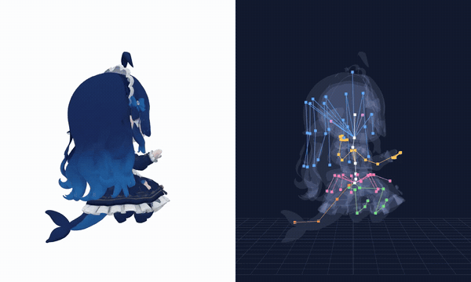
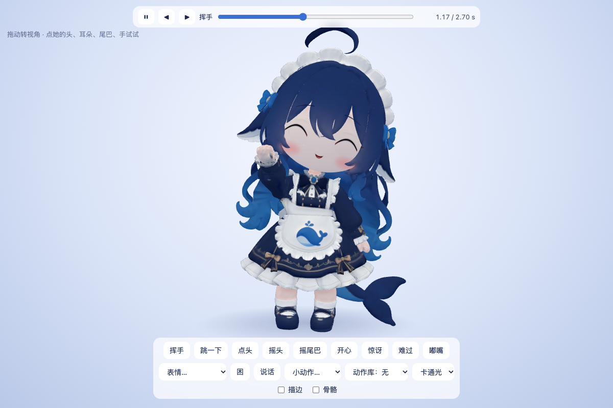

# Xiaojing · AI Whale Doll

[简体中文](README.md) · **English**

A 3D desktop companion who walks and climbs around the edges of your screen, plays little idle gestures, and gets dizzy when you spin her around. Connect your own AI service for speech bubbles, text chat, and optional comments on what you are working on.

<p align="center"></p>

**[Download](https://github.com/Tao-617/ai-whale-doll/releases/tag/v0.6.2)** · [Install and launch](#install-and-launch) · [Configure AI chat](#configure-ai-chat) · [Observation and movement](#observation-and-movement) · [Run from source](#run-from-source)

Current release: **0.6.2 preview**. The Mac app has been launched locally. The Windows version still needs testing on a real Windows desktop. Packages are not Apple-notarized or commercially code-signed for Windows, so first-launch security prompts may appear.

Choose **Language / 语言 → English** in the 🐳 menu or system tray. The first launch follows your system language; later launches remember your choice. Menus, chat controls, built-in chatter, and AI replies follow this setting. Chinese labels below are included as references.

## Preview

| Walking and climbing | Bubbles, waving, and dizziness |
| --- | --- |
|  |  |
| [8-second MP4](docs/media/walk-climb.mp4) | [10-second MP4](docs/media/expressions.mp4) |

These clips were recorded from the project's test page using the real model and animations. Speech bubbles contain fixed demo lines. No actual desktop content was captured and no cloud model was called. The native app controls desktop movement; these clips preview the poses in place.

### Quiet resting · 0.6.2

Walks are usually 2–4 minutes apart, sometimes longer while resting. At the bottom edge she can rest her cheeks in her hands, sit and eat rice, or sleep sprawled on her back. Choose a pose anytime under **Resting poses**. The bowl, rice, and spoon are procedural meshes; no extra model download is needed. Dragging or chatting interrupts rest.

The current source improves the cheek-rest pose and tail/skirt contact. Procedural, gently curved hands face the cheeks with fingers pointing up; cuffs follow the forearms, and the original hands return when the pose ends. Daydreaming can produce an occasional Chinese or English thought bubble: at most one per rest, at least a minute apart, controlled by **Occasional stroll and daydream chatter**.

She now sleeps on her back with arms and legs spread, eyes closed, a slightly open mouth, a little drool, and a nose bubble that grows and shrinks with her breathing. The desktop camera tilts down slightly to show her face. In the preview, you can orbit freely; leaving the sleep pose restores your previous view. The 0.6.2 downloads remain the previously published build.

Occasionally she performs an eight-second samba at the bottom edge, then rests again. Dances are at least eight minutes apart and never start during climbing or observation visits.


[15-second MP4](docs/media/resting.mp4). Random activity now aligns the visible character silhouette with the edge. Intentional observation visits may briefly enter the content area, then return to an edge before resuming idle activities.

### Four-limb climbing · 0.6.1

Xiaojing alternates handholds, bends her knees, and pushes with her feet, with a small weight shift between supports. The desktop pose faces partly away from you. Descending reverses the contact cycle; stopping holds the pose. Vertical travel is slower than walking, and the animation follows the actual travel speed.



[8-second model and skeleton comparison](docs/media/climb-rig.mp4). Her long hair and skirt obscure some far-side limbs; the skeleton view shows all four limbs participating.

<details>
<summary>Full test page screenshot</summary>



</details>

## Install and launch

The packages include the model, animations, and runtime. You do not need Python, Node, or development tools to use the desktop pet. On GitHub Releases, choose a DMG or EXE under **Assets**; **Source code** downloads are for development.

| Platform | Download | Requirements |
| --- | --- | --- |
| Mac | [Xiaojing-0.6.2-macOS-arm64.dmg](https://github.com/Tao-617/ai-whale-doll/releases/download/v0.6.2/Xiaojing-0.6.2-macOS-arm64.dmg) | Apple Silicon, macOS 14 or later; this package does not support Intel Macs |
| Windows | [Xiaojing-0.6.2-Windows-x64.exe](https://github.com/Tao-617/ai-whale-doll/releases/download/v0.6.2/Xiaojing-0.6.2-Windows-x64.exe) | Windows 10/11 x64; portable preview |

### Mac

1. Open the downloaded DMG and drag **Xiaojing.app** into **Applications**.
2. Launch Xiaojing from Applications. Use this installed copy for subsequent launches, rather than running from the disk image.
3. If macOS cannot verify the developer, confirm that you downloaded the package from this repository and follow [Apple's instructions](https://support.apple.com/en-us/102445) for **Open Anyway** in System Settings → Privacy & Security.
4. Look for the **🐳 icon in the menu bar at the top of your screen**. Xiaojing has no ordinary main window or Dock icon.

If the menu bar is hidden, leave full-screen mode. Right-clicking the pet also opens chat. If the pet is missing, choose **「回到屏幕右下角」** (Return to the bottom-right corner), and select **「桌宠（置顶，可以抓）」** (Desktop pet, always on top and draggable).

### Windows

1. Save the EXE in a folder you intend to keep, then double-click it.
2. Find Xiaojing in the **system tray at the bottom-right of the taskbar**. Use `^` to show hidden icons if necessary.
3. Click the tray icon for settings. Right-click the pet to open chat.
4. Choose **「回到右下角」** (Return to the bottom-right corner) if she is missing. Use **「退出」** (Quit) to close the app.

The Windows package is unsigned. Transparency, click-through behavior, the tray, and window capture still require verification on real Windows hardware.

### Try the local features first

These features need **no AI configuration or screen recording permission**:

- **「自由活动」** (Free activity): occasionally walk and climb around screen edges, with longer quiet rests.
- **Resting poses**: rest her cheeks in her hands, sit and eat rice, or sleep sprawled on her back.
- **Occasional stroll and daydream chatter**: local speech bubbles during walks or while resting her cheeks in her hands.
- Drag her body to move her. Pulling upward from below turns her upside down; pulling downward moves her normally. Spinning makes her dizzy.
- **「大小：小／中／大」** (Size: small/medium/large): resizing anchors her back to an edge.

## Configure AI chat

### 1. Choose a model service

You need your own API service and key. The app currently supports an **Anthropic Messages-compatible endpoint (`/v1/messages`)**. Observation additionally requires a model with **image input**. Your provider may charge for requests; this project includes no shared API key or free quota.

### 2. Enter the model settings

Open the 🐳 menu or system tray → **「模型设置…」** (Model settings), and fill in:

| Field | What to enter |
| --- | --- |
| API base URL | Your provider's HTTPS API base. For Anthropic's own service, use `https://api.anthropic.com`; for a compatible provider, use its own URL. URLs ending in `/v1` or `/v1/messages` are normalized automatically. Use the API address, not a chat website or dashboard URL. |
| Model name | The exact model ID available from your provider. Choose an image-capable model for observation. There is no universal default model ID. |
| API Key | A key issued by that provider with access to the selected model. Required on first setup; leaving it blank later preserves the existing key. |

Click **「保存」** (Save). Saving does not send a model request.

### 3. Test with one message

Choose **「和小鲸聊一句…」** (Chat with Xiaojing) and send a greeting. A reply in the chat window and bubble confirms that text requests work. You can also open chat by right-clicking Xiaojing or clicking a reply-enabled bubble.

Text chat does not automatically attach a screenshot. If the connection fails, check the API address, model ID, key permissions, and available quota. Services that only support a different protocol cannot currently be connected directly.

## Observation and movement

Observation starts paused on every launch, and the initial application allowlist is empty. Test text chat before enabling it.

### Mac: allow an app and grant screen recording access

1. Open an application you want Xiaojing to observe. Select it under **「允许观察的应用」** (Allowed applications) in the 🐳 menu.
2. Choose **「开启观察」** (Enable observation). macOS may request screen recording access.
3. Go to System Settings → Privacy & Security → **Screen & System Audio Recording** (or Screen Recording on earlier versions), and enable Xiaojing. If it is missing, use `+` to add the installed **Applications/Xiaojing.app**.
4. Quit and reopen Xiaojing if macOS asks you to, then choose **「开启观察」** again.

This feature does not read individual keystrokes. It does not require Input Monitoring or Accessibility permission.

### Windows: allow the foreground application

1. Switch to the application you want to observe, then open Xiaojing's tray menu.
2. Confirm that **「允许观察：…」** (Allow observation: …) names the intended app before selecting it. Review or remove entries under **「已允许的应用」** (Allowed applications).
3. Choose **「开启观察」** (Enable observation). The Windows version captures the selected window; failed or unavailable captures are skipped.

### Try an automatic response

Return to an allowed application, type or scroll, then stop for about 10 seconds while keeping that window in front. Automatic observation requires all of the following: at least 4 seconds without input, a stable window for at least 8 seconds, keyboard or mouse activity within the past minute, and at least 60 seconds since the previous observation. With no new activity, she stays quiet. The model can also choose not to speak.

For a manual test, choose **「看一眼当前窗口」** (Look at the current window). This sends a real request using your service quota. Return to the target window and pause briefly while waiting for the response.

### Let her approach the content before speaking

Enable both **「自由活动」** (Free activity) and **「截图后主动靠近内容（说完回边缘）」** (Approach content after a screenshot; return to the edge after speaking):

- **Random activity** stays along the four screen edges.
- **Observation movement** is optional: when the model identifies a specific point of interest, she may enter the content area briefly and return to an edge afterward.
- If there is no suitable point of interest, she can speak from her current position. A screenshot does not guarantee movement.

You can disable location-linked movement independently, or select **「暂停观察」** (Pause observation) to stop further observations.

## Troubleshooting

| Symptom | What to check |
| --- | --- |
| No ordinary window after launch | This is a desktop pet. Find the Mac menu bar or Windows tray icon and return her to the bottom-right corner. |
| macOS cannot verify the developer | The package is not notarized. Follow the Apple instructions above. This DMG requires Apple Silicon and macOS 14+. |
| She moves but cannot chat with AI | Local features work without AI. Fill in all three model settings and test one text message. |
| Connection incomplete / paused | Incomplete responses, timeouts, and service errors pause requests without automatic retries. Check configuration and quota, then try once manually. Re-enable observation separately. |
| Screen recording was allowed, but access is still denied | An update to an ad-hoc signed app may invalidate an old grant. Remove the old Xiaojing entry, add the currently installed app, and relaunch it. |
| Observation is enabled but she stays quiet | Check the allowlist, foreground window, and menu status. Close the chat window and menu, interact with the target app, then pause. No recent input, a changed window, dragging, or a quiet model response can all skip a comment. |
| Windows capture is black or unavailable | Some protected or hardware-accelerated windows may not support the current capture method. Try an ordinary window. Real Windows testing is still pending. |
| Voice chat? | Only text and speech bubbles are implemented. Voice is not connected yet. |

## Data and permissions

The app checks time since keyboard/mouse activity; it does not record typed characters or the clipboard. Observation captures only an allowed foreground window. Screenshots and chat text are sent to your configured model service and are not written to local logs by the app. Choose allowed applications deliberately and pause observation while viewing sensitive content.

API keys are stored in the Mac Keychain or encrypted through Windows system facilities. The repository and packages contain no developer API key, personal allowlist, or development-machine configuration. Uncertain network results pause requests without automatic retries.

## Run from source

### Get the source

```sh
git clone https://github.com/Tao-617/ai-whale-doll.git
cd ai-whale-doll
```

Alternatively, download and extract the repository ZIP, then run the commands from that project directory.

### Web test page

Requires Python 3. There is no frontend build step:

```sh
python3 scripts/serve.py
```

Open <http://127.0.0.1:8812/>. On Windows, use `py -3 scripts/serve.py` if `python3` is unavailable. Keep the terminal open; press `Ctrl+C` to stop.

The top-left “新动作预览” (New action previews) panel lets you try resting her cheeks in her hands, eating rice, sleeping, and samba. Click “停止预览 · 站起来” (Stop preview / stand up) to finish. Expression, material, and skeleton controls are also available; the top timeline supports pause, seeking, and frame stepping for the new resting poses too. `http://127.0.0.1:8812/?pet=1` previews the transparent pet page. System tray controls, desktop window movement, and observation require a desktop shell below.

### Mac: build and launch

Requires Xcode Command Line Tools and Node 24 installed through nvm. If necessary, run `xcode-select --install` and complete the system installation. With nvm installed:

```sh
nvm install 24
nvm use 24
sh desktop/build.sh
open desktop/build/Xiaojing.app
```

The build also copies `LICENSE` from the Node installation; nvm's standard installation layout provides the expected path. To create a DMG:

```sh
sh desktop/package-mac.sh
```

Output is under `desktop/dist/`. The script builds for the host architecture; the release provides an Apple Silicon package. Configure your own API service in Model settings after launching.

### Windows: build and launch

Install Node 24, then run from the project root:

```sh
cd desktop/windows
npm ci
npm test
npm run pack
```

Launch `Xiaojing-0.6.2-Windows-x64.exe` from `desktop/dist/windows/`. For development **on Windows**, run `npx electron .` inside `desktop/windows/`. See the [Windows development notes](desktop/windows/README.md).

## Validation and limitations

Swift geometry/resizing and observation policy checks, Python worker checks, and Windows Node tests pass. Climbing was reviewed using the real model and skeleton, including knee flexion, both travel directions, holding still, transitions to walking and dragging, and all three display sizes. AI-selected points of interest may be inaccurate. Windows multi-monitor DPI and capture compatibility remain unverified on real hardware; the Windows version does not include Mac wallpaper mode.

Run offline checks from the project root (Swift requires a Mac):

```sh
swiftc desktop/Roaming.swift tests/roam_policy.swift -o /tmp/xj-roam
/tmp/xj-roam
swiftc desktop/ObservationPolicy.swift tests/policy.swift -o /tmp/xj-policy
/tmp/xj-policy
python3 -m unittest discover -s tests -p 'test_*.py'
node --test desktop/windows/test/*.test.cjs
```

## Project layout and assets

`web/` contains the Three.js renderer and interactions; `desktop/` is the native Mac shell; `desktop/windows/` is the Windows Electron shell; `companion/` contains the AI request protocol; `tests/` holds offline checks; and `docs/media/` contains README demos.

Reference videos, original model work files, personal development notes, and build caches are excluded from the public repository. See [THIRD_PARTY_NOTICES.md](THIRD_PARTY_NOTICES.md) for component and animation credits. No unified open-source license has been assigned to the project's own code and character assets.
