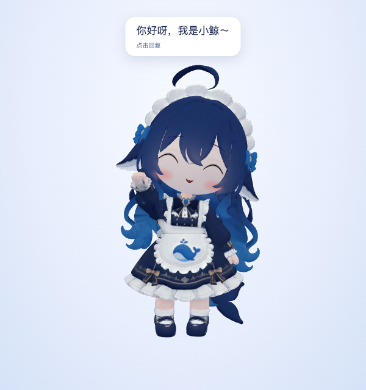
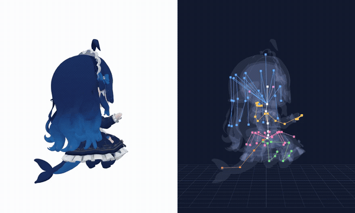
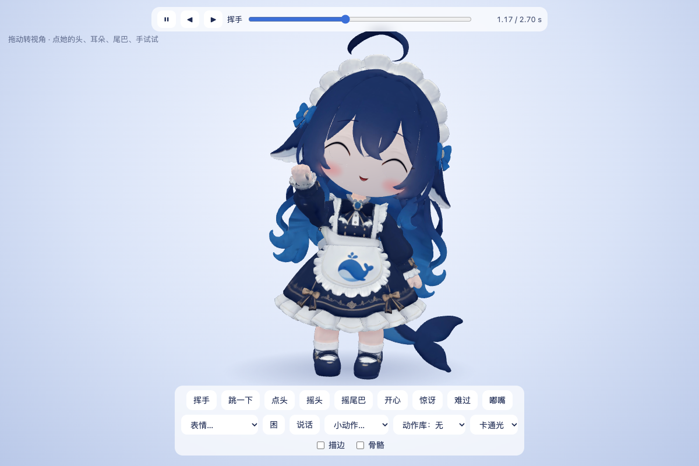

# 小鲸 · AI Whale Doll

**简体中文** · [English](README.en.md)

一个会沿屏幕边缘散步、攀爬、做小动作的 3D 桌宠。可以拎起来、抓着转圈，也可以配置 AI，让她用气泡聊天、偶尔看看你正在做什么。

<p align="center"></p>

**[下载安装包](https://github.com/Tao-617/ai-whale-doll/releases/tag/v0.6.1)** · [安装与启动](#安装与启动) · [配置 AI 聊天](#配置-ai-聊天) · [开启观察与主动移动](#开启观察与主动移动) · [从源码运行](#从源码运行)

当前为 **0.6.1 测试版**。Mac 已在本机启动验证；Windows 包由 Mac 交叉构建，尚待真实 Windows 桌面验收。安装包未做 Apple 公证或 Windows 商业代码签名，首次运行可能出现系统提示。

## 效果预览

| 走路与攀爬动作 | 气泡、挥手与转晕表情 |
| --- | --- |
|  |  |
| [查看 8 秒 MP4](docs/media/walk-climb.mp4) | [查看 10 秒 MP4](docs/media/expressions.mp4) |

以上素材录自项目测试页，使用固定镜头预览真实模型与动作；气泡是固定演示台词。录制没有读取真实桌面内容，也没有调用云端模型。桌面位置由原生外壳控制，因此这里展示的是原地动作预览。

### 四肢攀爬 · 0.6.1

攀爬时交替换手、抬膝和蹬腿，身体随支撑轻微转移重心。采用背面偏侧朝向；向下爬会反向换抓点，停住时保持姿势。沿侧边的速度比走路慢，动作节奏跟随实际位移。



[查看 8 秒模型／骨骼对照 MP4](docs/media/climb-rig.mp4)。长发和裙摆会遮住部分远侧肢体；右侧骨骼视图用于核对四肢是否实际参与。

<details>
<summary>查看完整测试页截图</summary>



</details>

## 安装与启动

只想使用桌宠，下载下表中的安装包即可。模型、动画和运行依赖都已包含，无须安装 Python、Node 或开发工具。GitHub 的 **Source code** 是源码，请在 Releases 的 **Assets** 中选择 DMG 或 EXE。

| 平台 | 下载 | 系统要求 |
| --- | --- | --- |
| Mac | [Xiaojing-0.6.1-macOS-arm64.dmg](https://github.com/Tao-617/ai-whale-doll/releases/download/v0.6.1/Xiaojing-0.6.1-macOS-arm64.dmg) | M 系列芯片，macOS 14 及以上；不支持 Intel Mac |
| Windows | [Xiaojing-0.6.1-Windows-x64.exe](https://github.com/Tao-617/ai-whale-doll/releases/download/v0.6.1/Xiaojing-0.6.1-Windows-x64.exe) | Windows 10/11 x64；免安装测试版 |

### Mac

1. 下载并打开 DMG，把 **Xiaojing.app** 拖进 **Applications / 应用程序**。
2. 到「应用程序」中双击 Xiaojing，后续也从这里启动。不要一直从 DMG 磁盘映像中运行。
3. 如果系统提示开发者无法验证，确认文件来自本仓库后，按 [Apple 官方说明](https://support.apple.com/en-us/102445) 到「系统设置 → 隐私与安全性」处理「仍要打开」提示。
4. 启动后小鲸出现在桌面上，设置入口是**屏幕顶部菜单栏的 🐳 图标**。她没有常规主窗口，也不会像普通应用一样显示 Dock 图标。

找不到菜单图标时，先退出全屏，让顶部菜单栏显示出来。右键小鲸也能打开聊天。找不到小鲸时，用 🐳 菜单的「回到屏幕右下角」，并确认选中「桌宠（置顶，可以抓）」模式。

### Windows

1. 下载 EXE，放进准备长期保存的文件夹，双击运行。
2. 小鲸出现后，在**任务栏右下角系统托盘**找到图标；如果没看到，点 `^` 展开隐藏图标。
3. 点击托盘图标打开设置菜单；右键小鲸可打开聊天。
4. 找不到小鲸时，使用托盘菜单的「回到右下角」。退出请使用同一菜单中的「退出」。

Windows 版本目前没有正式代码签名，可能出现发布者未验证提示。真实 Windows 下的透明窗口、鼠标穿透、托盘和截图兼容性仍待实机试用。

### 先试试本地功能

这些功能**不用配置 AI，也不用录屏权限**：

- 「自由活动」：沿四周边缘走动、攀爬，停下后做小动作。
- 「跑动时偶尔闲聊」：跑动时显示本地短台词。
- 抓住身体拖动；从下方往上提会倒立，往下拉则正常下移；转圈会转晕。
- 「大小：小／中／大」：切换尺寸后重新贴回边缘。

## 配置 AI 聊天

### 1. 准备模型服务

需要自己的 API 服务和密钥。当前支持 **Anthropic Messages 兼容接口（`/v1/messages`）**；截图观察还需要模型支持**图片输入**。服务商可能按调用量收费，项目不提供公共密钥或免费额度。

### 2. 填写模型设置

打开 🐳 菜单／系统托盘 → **「模型设置…」**，填写下列三项：

| 字段 | 怎么填 |
| --- | --- |
| API 根地址 | 服务商给出的 HTTPS API 根地址。使用 Anthropic 官方服务时填 `https://api.anthropic.com`；使用其他兼容服务时填它自己的地址。也支持地址末尾已有 `/v1` 或 `/v1/messages`，应用会规范化。请填写 API 地址，勿填写聊天网页或控制台网页地址。 |
| 模型名称 | 从服务商提供的可用模型列表复制完整模型 ID。用于观察时选支持视觉输入的模型。这里没有预设统一模型名称。 |
| API Key | 由对应服务商签发、且对该模型有权限的密钥。首次设置必填，之后留空会保留原密钥。 |

点击 **「保存」**。保存本身不会发起模型请求。

### 3. 发一句话确认连接

从菜单选择 **「和小鲸聊一句…」**，发送「你好，小鲸」。收到回复和气泡后，表示文字请求已跑通。也可以右键小鲸或点击可回复的气泡打开聊天窗口。

纯文字聊天不会自动附带截图。若连接失败，先检查 API 地址、模型 ID、密钥权限和服务额度；只支持其他接口协议的服务暂时不能直接接入。

## 开启观察与主动移动

观察每次启动默认暂停，允许的应用名单首次为空。建议先确认文字聊天能用，再进行以下设置。

### Mac：允许应用并授予录屏权限

1. 先打开希望小鲸观察的应用，在 🐳 菜单 → **「允许观察的应用」** 中勾选它。
2. 点击 **「开启观察」**。首次使用时系统会要求录屏权限。
3. 前往「系统设置 → 隐私与安全性 → **录屏与系统录音**」（较早系统可能称「屏幕录制」），开启 Xiaojing。如果列表里没有，使用 `+` 添加已经安装到「应用程序」的 `Xiaojing.app`。
4. 按系统提示退出并重新打开小鲸，随后再从 🐳 菜单点击 **「开启观察」**。

当前实现不读取具体键盘字符，因此不需要为这项功能额外开启「输入监控」或「辅助功能」权限。

### Windows：选择允许观察的前台应用

1. 先切到希望观察的应用，再打开小鲸的托盘菜单。
2. 确认 **「允许观察：…」** 显示的是目标应用，再勾选；已选择的应用可在 **「已允许的应用」** 中查看或移除。
3. 点击 **「开启观察」**。Windows 版通过指定窗口截图；如果窗口返回黑屏或无法捕获，会跳过这次观察。

### 试一次主动回应

切回被允许的应用，输入或滚动一下，随后停手约 10 秒并保持它在前台。自动观察需要同时满足：停手至少 4 秒、窗口稳定至少 8 秒、最近一分钟内有键鼠操作，并且距上一轮观察至少 60 秒。没有新输入时保持安静，模型也可以选择不说话。

需要主动测试时，可以选择 **「看一眼当前窗口」**。这是一次真实模型请求，使用自己的服务额度；切回目标窗口并稍停，等待回应。

### 让她走到内容旁边说话

同时开启 **「自由活动」** 和 **「截图后主动靠近内容（说完回边缘）」**：

- **随机活动**始终沿屏幕四周边缘进行。
- **截图主动移动**由模型选择：找到明确关注点时，可临时进入内容区，说完返回边缘。
- 没有合适关注点时，可以只在原处说话；并非每次截图都会走过去。

可以随时单独关闭位置联动，或使用「暂停观察」停止后续观察。

## 常见问题

| 现象 | 怎么处理 |
| --- | --- |
| 双击以后没看到普通窗口 | 小鲸是桌宠。Mac 看顶部 🐳 菜单，Windows 看右下角托盘；用菜单把她移回右下角。 |
| Mac 提示开发者无法验证 | 当前包未公证，按上面的 Apple 官方步骤处理。M 系列、macOS 14+ 才适用当前 DMG。 |
| 小鲸会走动，但不会 AI 聊天 | 本地功能不依赖 AI。到「模型设置」填写三项配置，先发送一句文字验证。 |
| 状态显示连接未完成／已暂停 | 返回不完整、超时或服务错误会暂停，程序不会自动重试。检查服务配置和额度后再手动试一次；观察需要重新开启。 |
| 已授权录屏，仍提示权限不足 | 更新临时签名版本后，旧授权可能失效。在系统录屏列表移除旧 Xiaojing，重新添加实际安装的当前应用，再重启。 |
| 开了观察，一直不说话 | 检查允许名单、当前前台窗口和菜单状态；关闭聊天窗口及展开的菜单，操作后停手。无新输入、窗口切换、抓取中或模型选择安静时都可能跳过。 |
| Windows 截图是黑屏／不可用 | 部分硬件加速或受保护窗口可能不支持当前捕获方式，可先换一个普通窗口试用。此版本仍需 Windows 实机验证。 |
| 能不能语音聊天 | 当前只有文字气泡，尚未接入语音。 |

## 数据与权限

只查询键鼠活动间隔，不记录键盘字符或剪贴板。观察只截允许的前台窗口；截图和聊天文字会发送到你配置的模型服务，应用不将它们写入本地日志。请自行选择愿意发送给模型的应用，查看敏感内容时暂停观察。

Mac 密钥保存在钥匙串，Windows 通过系统加密保存。仓库和安装包没有开发者的 API Key、个人应用名单或开发电脑配置。网络结果不确定时自动暂停，不自动重试请求。

## 从源码运行

### 取得源码

```sh
git clone https://github.com/Tao-617/ai-whale-doll.git
cd ai-whale-doll
```

也可以下载仓库 ZIP 并解压，在解压后的项目目录运行后面的命令。

### 网页测试页

需要 Python 3，无构建步骤。在项目根目录运行：

```sh
python3 scripts/serve.py
```

打开 <http://127.0.0.1:8812/>。Windows 如果没有 `python3` 命令，可使用 `py -3 scripts/serve.py`。保持终端运行，结束时按 `Ctrl+C`。

测试页可切换动作、表情、材质和骨骼，顶部进度条可暂停及逐帧查看。`http://127.0.0.1:8812/?pet=1` 是透明桌宠页面预览。托盘、桌面窗口移动和观察功能需要下面的桌面外壳。

### Mac：构建并启动桌面应用

需要 Xcode Command Line Tools，以及通过 nvm 安装的 Node 24。若尚未安装命令行工具，可先运行 `xcode-select --install` 并完成系统安装；已安装 nvm 后运行：

```sh
nvm install 24
nvm use 24
sh desktop/build.sh
open desktop/build/Xiaojing.app
```

构建脚本同时复制 Node 安装目录中的 `LICENSE`；使用 nvm 的标准安装目录可满足这个路径要求。需要制作 DMG 时再执行：

```sh
sh desktop/package-mac.sh
```

产物在 `desktop/dist/`。脚本按当前机器架构编译；发布页只提供已构建的 Apple Silicon 包。启动后仍需通过「模型设置」配置自己的 API 服务。

### Windows：构建并启动

安装 Node 24 后，在项目根目录运行：

```sh
cd desktop/windows
npm ci
npm test
npm run pack
```

然后到项目中的 `desktop/dist/windows/` 双击 `Xiaojing-0.6.1-Windows-x64.exe`。开发时可在 **Windows** 的 `desktop/windows/` 目录运行 `npx electron .`。详细实现见 [Windows 开发说明](desktop/windows/README.md)。

## 验证与限制

Swift 几何／缩放及观察策略检查、Python worker 检查、Windows Node 测试均通过。攀爬以真实模型的整体／骨骼视图检查，并验证双腿屈伸、上下方向、停步抓握、走路和抓取切换，以及三档尺寸的显示。模型关注点由 AI 判断，可能不准确。Windows 的多显示器 DPI 和截图兼容性尚待实机确认，且暂不包含 Mac 壁纸模式。

在项目根目录运行离线检查（Swift 部分需要 Mac）：

```sh
swiftc desktop/Roaming.swift tests/roam_policy.swift -o /tmp/xj-roam
/tmp/xj-roam
swiftc desktop/ObservationPolicy.swift tests/policy.swift -o /tmp/xj-policy
/tmp/xj-policy
python3 -m unittest discover -s tests -p 'test_*.py'
node --test desktop/windows/test/*.test.cjs
```

## 目录与素材

`web/` 是 Three.js 渲染与交互，`desktop/` 是 Mac 原生外壳，`desktop/windows/` 是 Windows Electron 外壳，`companion/` 是 AI 请求协议，`tests/` 是离线检查，`docs/media/` 是 README 展示素材。

下载的视频参考、原始模型工程、个人开发记录和构建缓存不在公开仓库。第三方组件与动画来源见 [THIRD_PARTY_NOTICES.md](THIRD_PARTY_NOTICES.md)。项目自有代码和角色素材暂未指定统一开源许可证。
